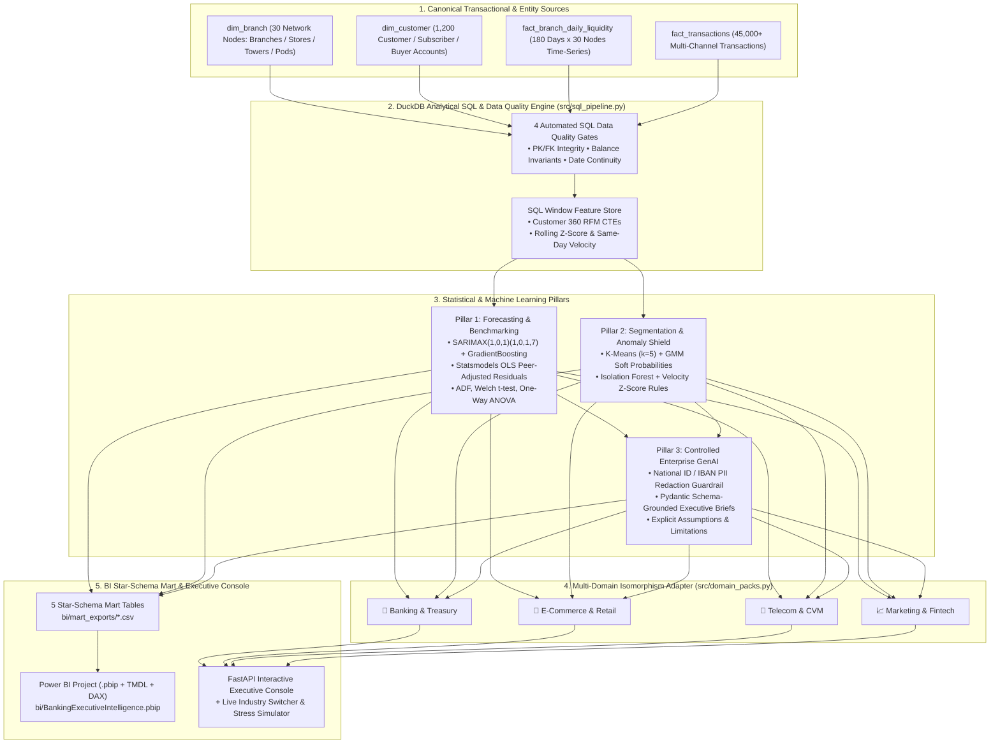

# Enterprise Multi-Domain Data Science, Forecasting, Customer 360 & Controlled GenAI BI Platform 🏦🛒📡📈

[](https://python.org)
[](https://duckdb.org)
[](https://www.statsmodels.org)
[](https://scikit-learn.org)
[-F2C811?style=flat)](https://powerbi.microsoft.com)
[](https://colab.research.google.com/github/akmalkhaniub/enterprise-banking-ds-platform/blob/main/notebooks/01_End_to_End_Banking_Experiments.ipynb)
[](https://kaggle.com/kernels/welcome?src=https://github.com/akmalkhaniub/enterprise-banking-ds-platform/blob/main/notebooks/01_End_to_End_Banking_Experiments.ipynb)
[](LICENSE)

> **Production-grade statistical econometrics, machine learning, analytical SQL feature store, and Power BI / Tableau Star-Schema intelligence platform engineered with a Canonical Multi-Domain Adapter across Banking, E-Commerce & Retail, Telecom, and Marketing/Fintech.**

---

## 🧠 Why a Multi-Domain Architecture? (Cross-Industry Mathematical Isomorphism)

A fundamental principle of production data science is that **customer and transactional decision problems are mathematically isomorphic across industries**. Whether a data scientist is analyzing **Commercial Banking**, **E-Commerce & Retail**, **Telecommunications**, or **Performance Marketing & Fintech**, the underlying data structures (`Entity/Node`, `Customer Account`, `Time-Stamped Transaction`, and `Daily Capacity Time-Series`) and statistical engines are identical—only the domain semantics change:

| Core Data Science Engine | 🏦 Banking & Treasury (`banking`) | 🛒 E-Commerce & Retail (`ecommerce_retail`) | 📡 Telecom & CVM (`telecom`) | 📈 Marketing & Fintech (`marketing_fintech`) |
| :--- | :--- | :--- | :--- | :--- |
| **1. Time-Series Forecasting** (`SARIMAX` + `GradientBoosting`) | Daily Branch Deposit Inflows & ATM Cash Replenishment Demand | Daily Store/Hub GMV & Warehouse SKU Stock Replenishment | Regional Recharge Inflow & Cell-Site Backhaul Bandwidth Load | Daily Attributed Revenue Inflow & Programmatic Ad Spend Pacing |
| **2. Peer Benchmarking & Hypothesis Testing** (`OLS Residuals`, `t-test`, `ANOVA`) | Branch Efficiency Index (controlling for Staff, ATMs, Catchment, OPEX) | Fulfillment Store Index (controlling for Headcount, SqFt, Catchment, OPEX) | Regional Tower Cluster Efficiency & 5G Bundle ARPU Lift | Growth Pod ROAS Incrementality & Channel Tier ANOVA |
| **3. Customer 360 Segmentation** (`RFM + K-Means + GMM`) | CASA Depositors (`Affluent_HNW`, `SME_Commercial`, `Salaried`, `Dormant`) | Shoppers (`VIP_Champions`, `B2B_Wholesale`, `App_Shoppers`, `Cart_Abandoners`) | Subscribers (`Platinum_Roamers`, `Enterprise_IoT`, `5G_Streamers`, `Multi_SIM_Churners`) | Cohorts (`Power_Advocates`, `Merchant_Partners`, `Promo_Converters`, `Bonus_Hunters`) |
| **4. Anomaly & Risk Detection** (`Isolation Forest` + `Velocity Z-Scores`) | AML Structuring (<2.5M threshold) & Midnight IBFT Account Takeover | Serial Refund/Coupon Stacking Abuse, Bot Scalping & Stolen-Card Voucher Drains | SIM-Box International Grey-Traffic Bypass & Wangiri Call Pumping | Click-Farm Invalid Traffic (IVT), Referral Rings & Promo Brute-Force Exploits |
| **5. Controlled GenAI & BI Mart** (`DuckDB SQL` + `Pydantic` + `Power BI`) | ALCO, Branch Ops & AML Compliance Executive Briefs | Merchandising, Supply Chain & Trust/Safety Briefs | Network Ops, CVM Retention & Revenue Assurance Briefs | CMO Growth Committee, Attribution & Ad-Fraud Briefs |

Rather than duplicating code across four separate repositories, this platform implements a **Canonical SQL & Mathematical Core** paired with **Switchable Industry Domain Packs** ([`src/domain_packs.py`](src/domain_packs.py) & [`src/domain_adapter.py`](src/domain_adapter.py)) selectable live in the Web Console header, REST API (`?domain=telecom`), and Jupyter Notebook.

---

## 🎯 Core Data Science & Engineering Capabilities

| Capability Domain | Engineering & Data Science Implementation | Verified Metric / Artifact |
| :--- | :--- | :--- |
| **Time-Series Forecasting & Regression** | `statsmodels` **SARIMAX(1,0,1)x(1,0,1,7)** with exogenous payday/festive/macro regressors + `scikit-learn` **Gradient Boosting** lag-feature ensemble (`src/forecasting_and_benchmarking.py`). | **3.02% Out-of-Time MAPE** (beats 7D seasonal naive baseline) across 30-day walk-forward backtest. |
| **Peer Benchmarking & Hypothesis Testing** | Peer-adjusted **Statsmodels OLS & Ridge Regression** residual efficiency index (`Actual / Expected * 100`) controlling for capacity, footprint, catchment population & OPEX + **ADF Stationarity**, **Welch's Two-Sample t-test**, and **One-Way ANOVA**. | **OLS $R^2 = 0.89$**; Strategic Campaign uplift **+13.9%** ($p < 0.001$); Peak Cycle surge **+37.1%** ($p < 10^{-8}$). |
| **Customer Segmentation & Clustering** | Customer 360 RFM (Recency, Frequency, Monetary) + behavioral feature store clustered via **K-Means ($K=5$)** and **Gaussian Mixture Models (GMM)** soft-probability assignment (`src/segmentation_and_anomaly.py`). | **5 Actionable Personas per Industry** with **Silhouette = 0.303**, 12-month CLV estimation, and automated Next-Best-Action playbooks. |
| **Transaction Anomaly Detection** | Hybrid **Unsupervised Isolation Forest (150 trees)** + statistical customer velocity Z-score & threshold structuring rules (`src/segmentation_and_anomaly.py`). | **F1 = 0.914**, **ROC-AUC = 0.9996** across **45,000** transactions (**679** high-risk alerts isolated). |
| **Strong SQL & Data Engineering Pipelines** | Analytical **DuckDB SQL** feature store (`src/sql_pipeline.py`) using multi-stage CTEs, `OVER (PARTITION BY ...)` window functions, and 4 automated Data Quality gates (PK uniqueness, FK integrity, accounting balance invariants, time-series continuity). | **4/4 Automated SQL Data Quality Checks Passing** with zero orphan keys or accounting breaks. |
| **Controlled Enterprise GenAI / LLMs** | Schema-constrained (`Pydantic v2`), **PII-redacting** (masks National IDs, IBANs, and customer IDs) executive synthesis engine (`src/genai_narrator.py`) with SHA-256 prompt auditability and explicit **Model Assumptions & Limitations** blocks. | Zero-hallucination Executive Briefs & Recommendations grounded strictly in SQL/ML metrics. |
| **Power BI / Tableau & Automated Dashboards** | Native **Power BI Project (`bi/BankingExecutiveIntelligence.pbip`)** with **TMDL Semantic Model**, pre-authored **DAX measures**, role-based security, 5 Star-Schema CSV exports (`bi/mart_exports/*.csv`), plus a live **FastAPI Executive Console** with Multi-Domain Switcher & What-If Stress Simulator. | Instant Power BI Desktop open + live interactive web console at `http://localhost:8000`. |

---

## 🏛️ System Architecture



---

## 📂 Repository Structure

```text
enterprise-banking-ds-platform/
├── bi/
│   ├── BankingExecutiveIntelligence.pbip                 # Native Power BI Project file
│   ├── BankingExecutiveIntelligence.Report/              # Power BI Report layout & 3 pages
│   ├── BankingExecutiveIntelligence.SemanticModel/       # TMDL Star Schema, Relationships, Roles & DAX Measures
│   └── mart_exports/                                     # Materialized Star-Schema CSVs for Power BI / Tableau
│       ├── DimBranchBenchmark.csv
│       ├── DimCustomerSegment.csv
│       ├── FactLiquidityForecast.csv
│       ├── FactTransactionAnomaly.csv
│       └── FactExecutiveRecommendation.csv
├── notebooks/
│   └── 01_End_to_End_Banking_Experiments.ipynb           # 1-Click Google Colab & Kaggle Notebook
├── src/
│   ├── domain_packs.py                 # 4 Switchable Industry Domain Packs (Banking, Retail, Telecom, Marketing)
│   ├── domain_adapter.py               # Projects canonical SQL/ML outputs into target industry semantics
│   ├── data_generator.py               # Realistic multi-entity transactional & seasonal time-series generator
│   ├── sql_pipeline.py                 # DuckDB SQL CTEs, Window functions & 4 Data Quality assertion gates
│   ├── forecasting_and_benchmarking.py # SARIMAX, GradientBoosting, OLS Benchmarking, ADF/t-test/ANOVA
│   ├── segmentation_and_anomaly.py     # RFM K-Means + GMM Clustering & Isolation Forest Anomaly Detection
│   ├── genai_narrator.py               # Controlled Enterprise GenAI Narrator with PII Redaction
│   ├── pipeline_runner.py              # End-to-end orchestrator exporting BI Mart & JSON artifacts
│   ├── api.py                          # FastAPI backend, Domain Switcher API & What-If Stress Simulator
│   └── static/index.html               # Human-centered Light/Dark Multi-Domain Executive Console
├── tests/
│   └── test_banking_ds_platform.py     # End-to-end Pytest suite (7 tests covering SQL, ML, PII, API, 4 Domains)
└── ci/ci.yml                           # Automated CI pipeline
```

---

## 🚀 Quickstart

### 1. Run the Full Data Science Pipeline & Generate Power BI Mart
```powershell
.\.venv\Scripts\python.exe -m src.pipeline_runner
```

### 2. Launch the Interactive Multi-Domain Executive Console
```powershell
.\.venv\Scripts\uvicorn.exe src.api:app --host 0.0.0.0 --port 8000
```
Then open **`http://localhost:8000`** in your browser. Use the **Industry Pack** selector in the top header (`🏦 Banking & Treasury`, `🛒 E-Commerce & Retail`, `📡 Telecom & CVM`, `📈 Marketing & Fintech`) to switch domains in real time across:
1. **Executive Brief & Recommendations** (with collapsible *Model Assumptions, Confidence Intervals & Known Limitations*)
2. **Time-Series Forecasting & What-If Stress Simulator**
3. **Peer Benchmarking & Statistical Hypothesis Tests** (`statsmodels` OLS peer-adjusted efficiency & Welch's *t*-test / ANOVA)
4. **Customer 360 Segmentation & High-Risk Anomaly Queue** (K-Means/GMM personas + Isolation Forest alerts)
5. **SQL Data Quality & Power BI (`.pbip`) Star-Schema Mart Downloads**

### 3. Run the Automated Test Suite
```powershell
.\.venv\Scripts\pytest.exe -v
```
