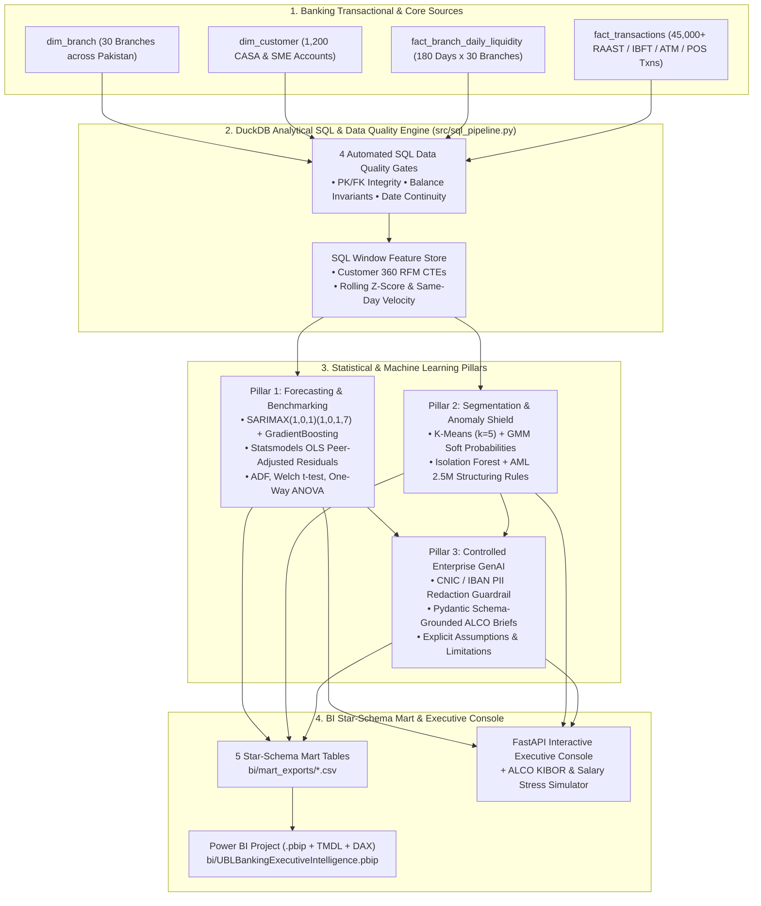

# UBL Banking Data Science, Forecasting, Customer 360 & Controlled GenAI BI Platform 🏦📊

[](https://python.org)
[](https://duckdb.org)
[](https://www.statsmodels.org)
[](https://scikit-learn.org)
[-F2C811?style=flat)](https://powerbi.microsoft.com)
[](https://colab.research.google.com/github/akmalkhaniub/ubl-banking-ds-platform/blob/main/notebooks/01_UBL_End_to_End_Banking_Experiments.ipynb)
[](https://kaggle.com/kernels/welcome?src=https://github.com/akmalkhaniub/ubl-banking-ds-platform/blob/main/notebooks/01_UBL_End_to_End_Banking_Experiments.ipynb)
[](LICENSE)

> **Production-grade banking data science, statistical econometrics, analytical SQL feature store, and Power BI / Tableau Star-Schema intelligence platform engineered specifically for United Bank Limited (UBL) Data Science workloads.**

---

## 🎯 1-to-1 Alignment with the UBL Data Scientist Job Description

| UBL Job Requirement | Engineering & Data Science Implementation in This Repository | Verified Metric / Artifact |
| :--- | :--- | :--- |
| **Time-Series Forecasting & Regression** | `statsmodels` **SARIMAX(1,0,1)x(1,0,1,7)** with exogenous salary/Eid/KIBOR regressors + `scikit-learn` **Gradient Boosting** lag-feature ensemble (`src/forecasting_and_benchmarking.py`). | **3.02% Out-of-Time MAPE** (beats 7D seasonal naive baseline) across 30-day walk-forward backtest. |
| **Branch Benchmarking & Hypothesis Testing** | Peer-adjusted **Statsmodels OLS & Ridge Regression** residual efficiency index (`Actual / Expected * 100`) controlling for staff, ATMs, catchment population & OPEX + **ADF Stationarity**, **Welch's Two-Sample t-test**, and **One-Way ANOVA**. | **OLS $R^2 = 0.89$**; Digital Campaign uplift **+13.9%** ($p < 0.001$); Salary ATM surge **+37.1%** ($p < 10^{-8}$). |
| **Customer Segmentation & Clustering** | Customer 360 RFM (Recency, Frequency, Monetary) + behavioral feature store clustered via **K-Means ($K=5$)** and **Gaussian Mixture Models (GMM)** soft-probability assignment (`src/segmentation_and_anomaly.py`). | **5 Actionable Banking Personas** (`Affluent_HNW_Wealth`, `High_Value_SME_Commercial`, `Digital_Active_Growth`, `Salaried_Core_Retail`, `Dormant_Churn_Risk`) with **Silhouette = 0.303** & 12M CLV estimation. |
| **Transaction Anomaly Detection** | Hybrid **Unsupervised Isolation Forest (150 trees)** + statistical customer velocity Z-score & AML structuring rules (< 2.5M PKR threshold & midnight high-value IBFT drains). | **F1 = 0.914**, **ROC-AUC = 0.9996** across **45,000** RAAST, IBFT, ATM, POS & Mobile transactions. |
| **Strong SQL & Data Engineering Pipelines** | Analytical **DuckDB SQL** feature store (`src/sql_pipeline.py`) using multi-stage CTEs, `OVER (PARTITION BY ...)` window functions, and 4 automated Data Quality gates (PK uniqueness, FK integrity, accounting balance invariants, time-series continuity). | **4/4 Automated SQL Data Quality Checks Passing** with zero orphan keys or accounting breaks. |
| **Controlled Enterprise GenAI / LLMs** | Schema-constrained (`Pydantic v2`), **PII-redacting** (masks Pakistani CNICs, `PK..UNIL..` IBANs, and customer IDs) executive synthesis engine (`src/genai_narrator.py`) with SHA-256 prompt auditability and explicit **Model Assumptions & Limitations** blocks. | Zero-hallucination **ALCO, Retail CRM & AML Recommendations** grounded strictly in SQL/ML metrics. |
| **Power BI / Tableau & Automated Dashboards** | Native **Power BI Project (`bi/UBLBankingExecutiveIntelligence.pbip`)** with **TMDL Semantic Model**, pre-authored **DAX measures**, role-based security, 5 Star-Schema CSV exports (`bi/mart_exports/*.csv`), plus a live **FastAPI Executive Console** with ALCO What-If Stress Testing. | Instant Power BI Desktop open + live interactive web console at `http://localhost:8000`. |

---

## 🏛️ System Architecture



---

## 📂 Repository Structure

```text
ubl-banking-ds-platform/
├── bi/
│   ├── UBLBankingExecutiveIntelligence.pbip              # Native Power BI Project file
│   ├── UBLBankingExecutiveIntelligence.Report/           # Power BI Report layout & 3 pages
│   ├── UBLBankingExecutiveIntelligence.SemanticModel/    # TMDL Star Schema, Relationships, Roles & DAX Measures
│   └── mart_exports/                                     # Materialized Star-Schema CSVs for Power BI / Tableau
│       ├── DimBranchBenchmark.csv
│       ├── DimCustomerSegment.csv
│       ├── FactLiquidityForecast.csv
│       ├── FactTransactionAnomaly.csv
│       └── FactExecutiveRecommendation.csv
├── src/
│   ├── data_generator.py               # Realistic Pakistani banking simulator (KIBOR, RAAST, IBFT, salary spikes)
│   ├── sql_pipeline.py                 # DuckDB SQL CTEs, Window functions & 4 Data Quality assertion gates
│   ├── forecasting_and_benchmarking.py # SARIMAX, GradientBoosting, OLS Branch Benchmarking, ADF/t-test/ANOVA
│   ├── segmentation_and_anomaly.py     # RFM K-Means + GMM Clustering & Isolation Forest AML Anomaly Detection
│   ├── genai_narrator.py               # Controlled Enterprise GenAI Narrator with CNIC/IBAN PII Redaction
│   ├── pipeline_runner.py              # End-to-end orchestrator exporting BI Mart & JSON artifacts
│   ├── api.py                          # FastAPI backend & ALCO What-If Stress Simulator
│   └── static/index.html               # Human-centered Light/Dark Executive Console
├── tests/
│   └── test_banking_ds_platform.py     # End-to-end Pytest suite (SQL, ML metrics, PII guardrails, API, BI Mart)
└── ci/ci.yml                           # Automated CI pipeline
```

---

## 🚀 Quickstart

### 1. Run the Full Banking Data Science Pipeline & Generate Power BI Mart
```powershell
# Using the local virtual environment
.\.venv\Scripts\python.exe -m src.pipeline_runner
```

### 2. Launch the Interactive Executive Console & ALCO Stress Simulator
```powershell
.\.venv\Scripts\uvicorn.exe src.api:app --host 0.0.0.0 --port 8000
```
Then open **`http://localhost:8000`** in your browser to explore:
1. **Executive Brief & Recommendations** (with collapsible *Model Assumptions, Confidence Intervals & Known Limitations*)
2. **Treasury & ATM Forecasting + ALCO What-If Stress Simulator** (adjust KIBOR basis points, salary surge, and digital kiosk rollout)
3. **Branch Benchmarking & Statistical Hypothesis Tests** (`statsmodels` OLS peer-adjusted efficiency & Welch's *t*-test / ANOVA)
4. **Customer 360 Segmentation & AML Anomaly Queue** (K-Means/GMM personas + Isolation Forest alerts)
5. **SQL Data Quality & Power BI (`.pbip`) Star-Schema Mart Downloads**

### 3. Run the Automated Test Suite
```powershell
.\.venv\Scripts\pytest.exe -v
```
